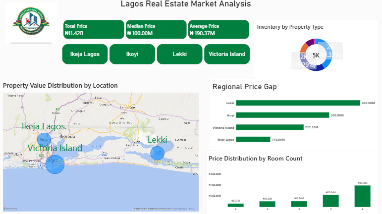

# Lagos Real Estate Market Analysis

## 📌 Project Overview
An interactive Power BI dashboard analyzing real estate trends, housing distributions, and pricing dynamics across Lagos, Nigeria. This project aims to uncover insights into property valuations based on location, features, and property types.

## 📊 Key Insights & Features
* *Interactive Dashboard:* Dynamic filtering by location (Ikeja, Lekki, Mainland, etc.), property type, and price range.
* *Price Distribution:* Identification of high-value real estate clusters and affordable housing hotspots.
* *Data Cleaning & Transformation:* Handled missing values, standardized location text, and parsed structural fields using Power Query.

## 🛠️ Tools Used
* *Power BI Desktop:* For data modeling, DAX calculations, and visual dashboard development.
* *Microsoft Excel:* For initial data preview and structured storage.
* ### Dashboard Overview

![Lagos Real Estate Market Dashboard 2](Screenshot%202026-10-14%20224720.png

## 📂 Files in this Folder
* Lagos Real Estate Project 2.pbix - The full interactive Power BI file.
